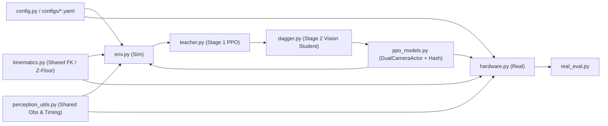

# SO-101 Bowling RL Architecture

## 1. Goal & Runtime Overview
Sim-to-real vision-based tabletop 3-pin bowling on the 6-DoF **SO-101** follower arm (`STS3215` servos via LeRobot):
- **DoF Split:** 4 active joints (`shoulder_pan`, `shoulder_lift`, `elbow_flex`, `wrist_flex`) + 2 held joints (`wrist_roll`, `gripper`) fixed at `home_qpos`.
- **Control & Physics:** 20 Hz control loop (`max_action_rad = 0.08`, 80-step / 4.0 s delivery horizon), 500 Hz MuJoCo physics (`physics_dt = 0.002`, 25 substeps/step).
- **Sensors:** Dual `64x112` RGB stacks (`wrist_rgb`, `tripod_rgb`, `frame_stack = 2`), `proprio`, and `camera_meta`.
- **Primary Sim-to-Real Training Path:** **Stage 1 Privileged Teacher PPO (`render_rgb=False`) -> Stage 2 DAgger Vision Student**. End-to-end vision PPO and SAC remain secondary baselines (SAC replay-buffer optimization is deferred until Teacher -> DAgger sim-to-real works).

## 2. Repo Commands
```bash
uv sync --frozen --extra dev                            # Dev / CI sim environment
uv sync --extra hardware --extra hub --extra tracking   # Optional hardware, HF Hub, W&B extras
uv run pytest -m smoke -q                               # Fast headless MuJoCo smoke (< 2 s)
uv run pytest -m "not hardware" -q                      # Full non-hardware test suite
uv run pytest -m hardware -q                            # Live SO-101 hardware tests only
```

## 3. Current Architecture (As-Is)

### Configurations (`configs/`) & Entrypoints (`scripts/`)
- **Workspace & Hardware:** `configs/workspace.yaml` (robot MJCF, ball/pin geometry, table/pad friction, camera poses, delivery/reward/DR parameters), `configs/so101_calibration.yaml` (joint limits, homing offsets, direction/norm modes), `configs/hardware.yaml` (serial port, UVC camera indices/FPS/rotations, safety margins, `dry_run: true`).
- **Algorithm Presets:** `teacher_dr.yaml` (Stage 1 privileged PPO), `dagger_dr.yaml` (Stage 2 spatial-grid DAgger), `ppo.yaml` / `ppo_dr.yaml`, and `sac.yaml` / `sac_dr.yaml`.
- **CLIs (`scripts/`):** `train_ppo.py`, `train_sac.py`, `eval_ppo.py`, `collect_dataset.py`, `compare_baselines.py`, `colab_train.py`, `launch_colab.py`, `push_to_hub.py`, `run_real_transfer.py`.

### Package Layers (`src/so101_bowling/`)
| Layer | Modules | Responsibility |
| :--- | :--- | :--- |
| Config & Assets | `config.py`, `assets.py`, `randomization.py` | YAML/calibration loading, MJCF + hollow pin mesh generation, physics/visual DR |
| Sim Env & Physics | `env.py`, `vec_env.py`, `scorer.py`, `kinematics.py` | Gymnasium env, sync/subproc vec envs, substep delivery scorer, 4-DoF DLS IK & scripted push |
| Shared Perception | `perception_utils.py` | Center-crop/resize (`64x112`), `CameraDelayBuffer`, `TimestampedFrameStack`, `CausalJointVelocityEstimator`, `scale_proprio` |
| RL Stack | `teacher.py`, `dagger.py`, `ppo.py`, `ppo_models.py`, `sac.py`, `sac_models.py`, `replay_buffer.py`, `dataset.py` | Stage 1 privileged PPO teacher, Stage 2 DAgger vision student, asymmetric PPO/SAC baselines |
| Hardware & Eval | `hardware.py`, `real_eval.py` | Timestamped UVC cameras, FK/workspace `SafetyGuard`, `SO101BowlingHardwareBridge`, trial diagnostics |
| Ops & Artifacts | `hub.py`, `tracking.py` | Hugging Face Hub dataset/model sync and optional W&B experiment logging |

### Observation & Action Contracts
- **Actor Obs:**
  - `wrist_rgb`, `tripod_rgb`: `(2, 64, 112, 3) uint8` (oldest-to-newest frame stack).
  - `camera_meta`: `(4,) float32` (age in seconds capped at 10.0 and freshness flag per camera).
  - `proprio`: `(12,) float32` (normalized `q_meas`, `dq_meas`, `prev_applied_delta` in `[-1, 1]`).
- **Critic / Aux Obs (Sim Only):** `privileged_state` `(46,) float32`, `privileged_aux_targets` `(6,) float32`, `privileged_aux_mask` `(3,) float32`.
- **Action:** `Box(-1.0, 1.0, (4,), float32)` delta commands scaled by `max_action_rad` (`0.08` rad/step).

## 4. Target Module Boundaries & Sim-to-Real Invariants



### Target Invariants (Cross-Module Contracts)
1. **Atomic Control Law (`env.py` <-> `hardware.py`):**
   - Replace per-step `q_meas + delta` drift with a leashed integrated `q_cmd` (no MJCF `gravcomp`).
   - Re-sync `q_cmd <- q_meas` on reset/recovery, freeze `q_cmd` on safe-hold, and expose `q_cmd - q_meas` tracking error in actor `proprio`.
2. **Shared Z-Floor Safety (`kinematics.py` -> `env.py` & `hardware.py`):**
   - Use analytical FK `project(q_cmd)` above the table surface in both domains; apply a soft floor penalty in sim and a tighter hard E-stop margin (`z_floor_margin_m`) on real hardware.
3. **Shot-Clock & Velocity Parity (`perception_utils.py`):**
   - Expose a normalized remaining-time scalar in actor `proprio` while keeping `delivery_timeout` as `terminated=True` with an explicit no-release miss penalty.
   - Any velocity midpoint estimation change affecting shared `perception_utils.py` must land **pre-retrain**; live camera identity binding, exposure lock, and real-eval pin-tilt parity remain strictly hardware/eval-side (`hardware.py` / `real_eval.py`).
4. **Artifact Compatibility (`env_render_hash`):**
   - Stamp trained checkpoints and DAgger datasets with a deterministic hash of env, observation, action, and render configuration; fail fast on load or resume mismatch.
5. **Hardware Safety Boundary (`hardware.py`):**
   - Enforce `move_to_home()` before episodes, an explicit `--live` confirmation gate, controlled-descent E-stop + comms-loss watchdog (`max_joint_stale_s`, `max_camera_age_s`), STS3215 register verification, and camera identity binding by serial/device path.
